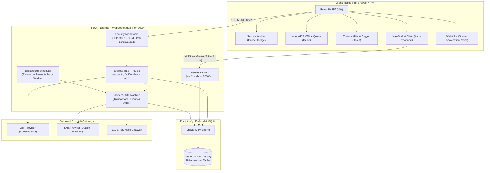
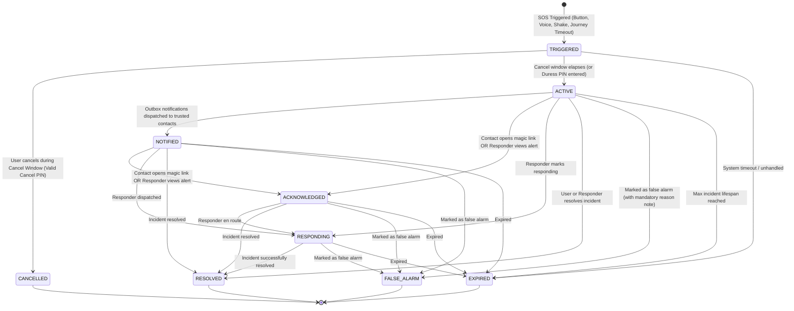

# SHAKTI System Architecture

## 1. System Overview

SHAKTI is architected as an offline-capable, single-port Progressive Web Application (PWA) backed by an Express REST API, a live WebSocket broadcast hub, and an embedded SQLite database managed via Drizzle ORM.

### Mermaid Component Architecture

---

## 2. Data Model Overview

The embedded SQLite database consists of 17 relational tables strictly enforcing privacy, consent, and auditability:

1. **`users`**: User identity records (`id`, `phone_e164`, `name`, `role`, `language`, `organization_zone`, `cancel_pin_hash`, `duress_pin_hash`, `cancel_window_seconds`, `created_at`, `updated_at`).
2. **`otp_codes`**: Transient verification codes with strict 5-minute expiry, salt hashes, and attempt counters.
3. **`consents`**: Append-only consent ledger recording individual grant/revocation timestamps, categories (`data_processing`, `location`, `emergency_sharing`), and consent sources.
4. **`trusted_contacts`**: User-managed emergency contacts (capped at 5 per user) with individual permission flags (`receives_sos`, `receives_checkin`, `can_see_live_location`) and status (`invited`, `accepted`, `declined`, `paused`).
5. **`contact_invitations`**: Secure tokens (`inv_<random>`) for inviting trusted contacts to join a user's safety circle.
6. **`contact_incident_tokens`**: Ephemeral signed tokens (`ctk_<nonce>.<sig>`) granting contact-specific read access to an active incident via magic link.
7. **`incidents`**: Emergency incident records (`id`, `user_id`, `status`, `emergency_type`, `duress`, `source_trigger`, `created_at`, `activated_at`, `closed_at`).
8. **`incident_events`**: Immutable timeline of state transitions recording `from_status`, `to_status`, `actor_type`, and `actor_id` in the same transaction as the state change.
9. **`location_samples`**: Real-time GPS coordinates recorded strictly during active incidents with valid `location` consent, flagged with `expires_at` retention timestamps.
10. **`notifications`**: Internal notification dispatch records tracking recipient delivery states and escalation steps.
11. **`sent_messages`**: Outbox history capturing SMS dispatch bodies, destinations, and timestamps for testing and delivery auditing.
12. **`responders`**: Verified community and campus responder accounts linked to specific organization zones with on-duty status flags.
13. **`incident_assignments`**: Tracking which responder is actively assigned to an incident.
14. **`incident_access_audit` (`audit_log`)**: Tamper-evident audit log recording every access to sensitive incident data, responder views, and administrative actions.
15. **`journeys`**: Safe Journey tracking records (`id`, `user_id`, `status`, `starts_at`, `expected_arrival_at`, `extended_count`, `note`).
16. **`reports`**: Anonymized safety hazard reports with k-anonymity geo-binning and automated daily report caps.
17. **`resources`**: Directory of 24x7 emergency helplines (112, 181, One Stop Centres, campus desks).
18. **`safety_pulses` & `post_incident_ratings`**: Anonymized weekly wellness check-ins and incident resolution feedback.

---

## 3. Incident State Machine

The incident lifecycle strictly implements the state transition model defined in `apps/api/src/services/incidentStateMachine.ts`. State transitions are transactional and immutable: any attempt to transition between disallowed states throws an HTTP `400` error and is rejected.

### Mermaid State Diagram

### State Machine Properties:
- **Terminal States:** `RESOLVED`, `CANCELLED`, `FALSE_ALARM`, and `EXPIRED` are terminal; no further transitions are allowed.
- **Location Retention:** Upon reaching any terminal state, `expires_at` is immediately calculated and set on all associated `location_samples` for retention purging.
- **Duress Handling:** When a user enters a Duress PIN during the `TRIGGERED` window, the client UI mimics `CANCELLED`, but the server immediately transitions the incident to `ACTIVE` (with `duress=1`) and notifies responders silently.
