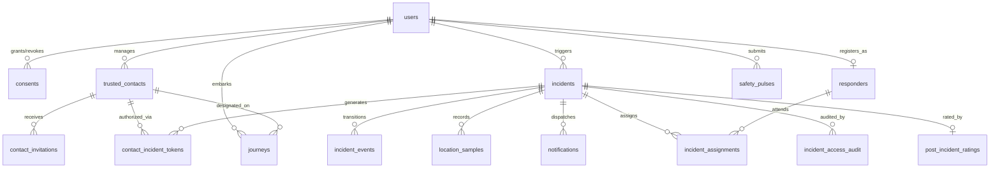

# SAATHI — Backend Schema & System Architecture Document
**Safety Assistance & Alert Technology for Help & Intervention**  
**Document Version:** 1.0 (MVP Canonical Schema & Architecture Specification)  
**Status:** Approved & Implemented  
**Date:** October 2026  

---

## 1. System Architecture Overview

SAATHI's backend is architected around an embedded, relational SQL persistence layer managed via **Drizzle ORM** with versioned migrations, paired with an **Express REST API** and a live **`ws` WebSocket broadcast hub**.

```
┌────────────────────────────────────────────────────────────────────────┐
│                        CLIENT / PWA (PORT 3000)                        │
├───────────────────┬─────────────────────┬──────────────────────────────┤
│ React 19 SPA      │ Dexie IndexedDB     │ Service Worker (Workbox)     │
│ Zustand Stores    │ Offline Event Queue │ Offline Shell & CacheStorage │
└─────────┬─────────┴──────────┬──────────┴──────────────┬───────────────┘
          │ HTTPS REST         │ WSS Real-Time           │ Periodic Sync
          ▼                    ▼                         ▼
┌────────────────────────────────────────────────────────────────────────┐
│                 EXPRESS REST & WEBSOCKET ENGINE (PORT 3000)            │
├────────────────────────────────────────────────────────────────────────┤
│ • Security Middleware (Helmet CSP, CORS, CSRF, Sliding-Window Limits)  │
│ • Authentication & RBAC Middleware (JWT Bearer / httpOnly Cookies)     │
│ • Incident State Machine (Transactional Transition Enforcer)           │
│ • WebSocket Hub (Channel-based Incident & Zone Broadcasts)             │
│ • Background Scheduler (Escalation Engine & Location Retention Purger) │
└───────────────────────────────────┬────────────────────────────────────┘
                                    │ Drizzle ORM
                                    ▼
┌────────────────────────────────────────────────────────────────────────┐
│               EMBEDDED RELATIONAL SQLITE (saathi.db)                   │
├────────────────────────────────────────────────────────────────────────┤
│ • WAL Mode Enabled (Write-Ahead Logging for Concurrent R/W)            │
│ • 19 Normalized Relational Tables Enforcing Constraints & Indices      │
│ • Fully Compatible with Zero-Refactor PostgreSQL Migration             │
└────────────────────────────────────────────────────────────────────────┘
```

---

## 2. Authentication & Cryptographic Architecture

### 2.1 Passwordless Phone OTP Flow
1. **Request (`POST /api/auth/otp/request`):**
   - User submits phone number formatted in E.164 (`+919000000001`).
   - A 6-digit random code is generated: `crypto.randomInt(100000, 999999)`.
   - The code is hashed using PBKDF2 (`crypto.pbkdf2Sync(code, salt, 10000, 64, 'sha512')`).
   - Inserted into `otp_codes` with `expires_at = Date.now() + 300_000` (5 minutes) and `attempts = 0`.
   - In production, dispatched via `SmsProvider`; in dev, logged to terminal console.
2. **Verification (`POST /api/auth/otp/verify`):**
   - User submits phone number and 6-digit code.
   - If `attempts >= 3` or `Date.now() > expires_at`, the code is rejected with HTTP `400 Bad Request`.
   - Hash is matched. On success, an access token (15m) and refresh token (7d) are issued.

### 2.2 JWT Session & Refresh Token Rotation
- **Access Token:** Stored in `saathi_access` cookie (or `Authorization: Bearer <token>`). Payload: `{ sub: userId, role: 'user'|'responder'|'admin', zone: string }`.
- **Refresh Token:** Stored in `saathi_refresh` cookie (`httpOnly: true, secure: true, sameSite: 'lax'`).
- **Token Rotation (`POST /api/auth/refresh`):** Reading the refresh cookie verifies the user in the database, invalidates the existing token, and issues a fresh pair.

### 2.3 Safety PIN Encryption (Cancel & Duress)
- **Cancel PIN:** 4 digits used to gracefully abort an active emergency during the countdown window.
- **Duress PIN:** 4 digits used when under physical coercion.
- **Storage:** Stored in `users.cancel_pin_hash` and `users.duress_pin_hash` as salted PBKDF2 strings (`pbkdf2:10000:<salt>:<hash>`). PINs are never stored in plain text and are excluded from user export objects.

### 2.4 Ephemeral Contact Magic Links
- When an alert triggers, trusted contacts receive a magic link `/c/:token`.
- **Structure:** `ctk_<nonce>.<hmacSignature>`.
- The backend verifies the HMAC signature using `HMAC_SECRET_KEY` and confirms that `expires_at` has not lapsed.
- Contact views and actions do not require user login and are strictly rate-limited.

---

## 3. Complete Database Schema (19 Tables)

All tables are defined in `apps/api/src/db/schema.ts` using Drizzle ORM.

### 3.1 `users`
Core user identity records representing survivors, responders, and administrators.

| Column | SQL Type | Nullable | Default | Description |
| :--- | :--- | :--- | :--- | :--- |
| `id` | `TEXT` | `NO` | PK | Primary Key (UUIDv4) |
| `phone_e164` | `TEXT` | `NO` | — | Unique phone number in E.164 format (e.g., `+919000000001`) |
| `name` | `TEXT` | `NO` | — | User's full name or display pseudonym |
| `role` | `TEXT` | `NO` | `'user'` | Role enum: `'user'`, `'responder'`, `'admin'` |
| `language` | `TEXT` | `NO` | `'en'` | Preferred interface language: `'en'` or `'hi'` |
| `organization_zone`| `TEXT` | `NO` | `'Demo Campus Zone'` | Campus or municipal security zone |
| `cancel_window_seconds` | `INTEGER` | `NO` | `5` | Duration of SOS cancellation countdown (5–30s) |
| `cancel_pin_hash` | `TEXT` | `YES` | `NULL` | Salted PBKDF2 hash of 4-digit Cancel PIN |
| `duress_pin_hash` | `TEXT` | `YES` | `NULL` | Salted PBKDF2 hash of 4-digit Duress PIN |
| `created_at` | `TEXT` | `NO` | — | ISO-8601 creation timestamp |

- **Indices:** `idx_users_phone_e164` (Unique Index on `phone_e164`).

---

### 3.2 `otp_codes`
Transient phone verification codes.

| Column | SQL Type | Nullable | Default | Description |
| :--- | :--- | :--- | :--- | :--- |
| `id` | `TEXT` | `NO` | PK | Primary Key (UUIDv4) |
| `phone_e164` | `TEXT` | `NO` | — | Target phone number |
| `code_hash` | `TEXT` | `NO` | — | Salted PBKDF2 hash of the 6-digit OTP code |
| `expires_at` | `INTEGER` | `NO` | — | Unix epoch millisecond expiration timestamp (now + 5m) |
| `attempts` | `INTEGER` | `NO` | `0` | Number of failed verification attempts (max 3) |
| `created_at` | `TEXT` | `NO` | — | ISO-8601 creation timestamp |

- **Indices:** `idx_otp_codes_phone_e164` on `phone_e164`.

---

### 3.3 `consents`
Append-only immutable audit ledger recording individual consent grants and revocations.

| Column | SQL Type | Nullable | Default | Description |
| :--- | :--- | :--- | :--- | :--- |
| `id` | `TEXT` | `NO` | PK | Primary Key (UUIDv4) |
| `user_id` | `TEXT` | `NO` | — | FK reference to `users.id` |
| `type` | `TEXT` | `NO` | — | Enum: `'location'`, `'notifications'`, `'microphone'`, `'camera'`, `'data_processing'` |
| `granted` | `INTEGER` | `NO` | — | Boolean (1 = granted, 0 = revoked) |
| `created_at` | `TEXT` | `NO` | — | ISO-8601 timestamp of consent change |
| `source` | `TEXT` | `NO` | — | Audit context (e.g., `'onboarding_step'`, `'settings_toggle'`) |

- **Indices:** `idx_consents_user_id` on `user_id`.

---

### 3.4 `trusted_contacts`
User-configured personal emergency circle (capped at 5 contacts per user).

| Column | SQL Type | Nullable | Default | Description |
| :--- | :--- | :--- | :--- | :--- |
| `id` | `TEXT` | `NO` | PK | Primary Key (UUIDv4) |
| `user_id` | `TEXT` | `NO` | — | FK reference to `users.id` (contact owner) |
| `name` | `TEXT` | `NO` | — | Contact's name |
| `phone_e164` | `TEXT` | `NO` | — | Contact's phone number |
| `priority_order` | `INTEGER` | `NO` | `1` | Escalation ladder priority (1 = primary contact) |
| `permissions` | `TEXT` | `NO` | — | JSON object: `{ receives_sos: bool, receives_checkin: bool, can_see_live_location: bool }` |
| `status` | `TEXT` | `NO` | `'invited'` | Enum: `'invited'`, `'accepted'`, `'paused'`, `'removed'` |
| `created_at` | `TEXT` | `NO` | — | ISO-8601 timestamp |
| `updated_at` | `TEXT` | `NO` | — | ISO-8601 timestamp |

- **Indices:** `idx_trusted_contacts_user_id` on `user_id`.

---

### 3.5 `contact_invitations`
Cryptographic tokens for onboarding trusted contacts to a user's circle.

| Column | SQL Type | Nullable | Default | Description |
| :--- | :--- | :--- | :--- | :--- |
| `id` | `TEXT` | `NO` | PK | Primary Key (UUIDv4) |
| `contact_id` | `TEXT` | `NO` | — | FK reference to `trusted_contacts.id` |
| `token_hash` | `TEXT` | `NO` | — | SHA-256 hash of public invitation token (`inv_<token>`) |
| `expires_at` | `INTEGER` | `NO` | — | Unix epoch expiration timestamp (7 days) |
| `accepted_at` | `TEXT` | `YES` | `NULL` | ISO-8601 timestamp when contact accepted |
| `created_at` | `TEXT` | `NO` | — | ISO-8601 creation timestamp |

- **Indices:** `idx_contact_invitations_contact_id` on `contact_id`; `idx_contact_invitations_token_hash` (Unique).

---

### 3.6 `sent_messages`
Outbound message audit log tracking all SMS and notification dispatches.

| Column | SQL Type | Nullable | Default | Description |
| :--- | :--- | :--- | :--- | :--- |
| `id` | `TEXT` | `NO` | PK | Primary Key (UUIDv4) |
| `to_phone_e164` | `TEXT` | `NO` | — | Destination phone number |
| `body` | `TEXT` | `NO` | — | Message content |
| `provider` | `TEXT` | `NO` | — | Gateway provider (e.g., `'mock_sms'`, `'twilio'`) |
| `purpose` | `TEXT` | `NO` | — | Message category: `'otp'`, `'sos_alert'`, `'journey_start'` |
| `metadata` | `TEXT` | `YES` | `NULL` | JSON metadata dictionary |
| `created_at` | `TEXT` | `NO` | — | ISO-8601 timestamp |

- **Indices:** `idx_sent_messages_created_at` on `created_at`.

---

### 3.7 `incidents`
Core emergency records managing alert lifecycle and escalation states.

| Column | SQL Type | Nullable | Default | Description |
| :--- | :--- | :--- | :--- | :--- |
| `id` | `TEXT` | `NO` | PK | Primary Key (UUIDv4) |
| `user_id` | `TEXT` | `NO` | — | FK reference to `users.id` (victim / survivor) |
| `status` | `TEXT` | `NO` | — | Lifecycle status enum (see State Machine section) |
| `emergency_type`| `TEXT` | `YES` | `NULL` | Optional category: `'medical'`, `'harassment'`, `'stalking'`, `'accident'` |
| `client_request_id` | `TEXT` | `NO` | — | Client-generated UUID for idempotent offline sync |
| `client_created_at` | `TEXT` | `YES` | `NULL` | Client-reported creation timestamp |
| `queued_offline`| `INTEGER` | `NO` | `0` | Boolean: indicates whether incident was captured offline |
| `created_at` | `TEXT` | `NO` | — | Server creation timestamp (ISO-8601) |
| `activated_at` | `TEXT` | `YES` | `NULL` | Timestamp when cancel window expired and alert went active |
| `closed_at` | `TEXT` | `YES` | `NULL` | Timestamp when incident reached terminal state |
| `merged_into_id`| `TEXT` | `YES` | `NULL` | For incident de-duplication or merging |
| `source_trigger`| `TEXT` | `NO` | `'button'` | Trigger origin: `'button'`, `'triple_tap'`, `'shake'`, `'voice'`, `'journey_timeout'` |
| `is_duress` | `INTEGER` | `NO` | `0` | Boolean: silent duress flag activated by Duress PIN |
| `pin_attempts` | `INTEGER` | `NO` | `0` | Failed PIN cancellation attempts |
| `needs_user_action` | `INTEGER` | `NO` | `0` | Flag indicating user attention requested |
| `escalation_stage` | `INTEGER` | `NO` | `0` | Escalation ladder stage (0 = primary, 1 = secondary, 2 = responders) |
| `is_demo` | `INTEGER` | `NO` | `0` | Boolean: flags test/demo mode records for clean resets |

- **Indices:** `idx_incidents_user_id` on `user_id`; `idx_incidents_user_client_request` (Unique compound on `[user_id, client_request_id]`).

---

### 3.8 `incident_events`
Immutable audit timeline recording every state transition and operator action.

| Column | SQL Type | Nullable | Default | Description |
| :--- | :--- | :--- | :--- | :--- |
| `id` | `TEXT` | `NO` | PK | Primary Key (UUIDv4) |
| `incident_id` | `TEXT` | `NO` | — | FK reference to `incidents.id` |
| `from_status` | `TEXT` | `YES` | `NULL` | Previous lifecycle status |
| `to_status` | `TEXT` | `NO` | — | New lifecycle status |
| `actor_type` | `TEXT` | `NO` | — | Enum: `'user'`, `'contact'`, `'responder'`, `'system'` |
| `actor_id` | `TEXT` | `YES` | `NULL` | ID of the acting entity |
| `note` | `TEXT` | `YES` | `NULL` | Explanation or mandatory false-alarm justification |
| `created_at` | `TEXT` | `NO` | — | ISO-8601 timestamp |

- **Indices:** `idx_incident_events_incident_id` on `incident_id`.

---

### 3.9 `location_samples`
Real-time GPS coordinate telemetry captured strictly during active incidents.

| Column | SQL Type | Nullable | Default | Description |
| :--- | :--- | :--- | :--- | :--- |
| `id` | `TEXT` | `NO` | PK | Primary Key (UUIDv4) |
| `incident_id` | `TEXT` | `NO` | — | FK reference to `incidents.id` |
| `lat` | `REAL` | `NO` | — | Latitude coordinate |
| `lng` | `REAL` | `NO` | — | Longitude coordinate |
| `accuracy_m` | `REAL` | `YES` | `NULL` | GPS accuracy radius in meters |
| `captured_at` | `TEXT` | `NO` | — | Client capture timestamp (ISO-8601) |
| `expires_at` | `INTEGER` | `NO` | — | Retention purge deadline (Unix epoch ms) |

- **Indices:** `idx_location_samples_incident_id` on `incident_id`.

---

### 3.10 `contact_incident_tokens`
Signed, single-incident magic link tokens granting contacts temporary view access.

| Column | SQL Type | Nullable | Default | Description |
| :--- | :--- | :--- | :--- | :--- |
| `id` | `TEXT` | `NO` | PK | Primary Key (UUIDv4) |
| `incident_id` | `TEXT` | `NO` | — | FK reference to `incidents.id` |
| `contact_id` | `TEXT` | `NO` | — | FK reference to `trusted_contacts.id` |
| `token_hash` | `TEXT` | `NO` | — | SHA-256 hash of signed contact token |
| `expires_at` | `INTEGER` | `NO` | — | Unix epoch expiration timestamp |
| `created_at` | `TEXT` | `NO` | — | ISO-8601 timestamp |

- **Indices:** `idx_contact_incident_tokens_hash` (Unique); `idx_contact_incident_tokens_pair` (Unique compound on `[incident_id, contact_id]`); `idx_contact_incident_tokens_incident_id`.

---

### 3.11 `responders`
Verified security personnel and campus patrol responders.

| Column | SQL Type | Nullable | Default | Description |
| :--- | :--- | :--- | :--- | :--- |
| `id` | `TEXT` | `NO` | PK | Primary Key (UUIDv4) |
| `user_id` | `TEXT` | `NO` | — | FK reference to `users.id` |
| `organization_zone`| `TEXT` | `NO` | `'Demo Campus Zone'` | Assigned operational sector |
| `active` | `INTEGER` | `NO` | `1` | Boolean: active responder status |
| `on_duty` | `INTEGER` | `NO` | `1` | Boolean: current on-duty availability |
| `created_at` | `TEXT` | `NO` | — | ISO-8601 timestamp |
| `updated_at` | `TEXT` | `NO` | — | ISO-8601 timestamp |

- **Indices:** `idx_responders_user_id` (Unique on `user_id`); `idx_responders_org_zone`.

---

### 3.12 `incident_assignments`
Tracks responder assignments to specific emergencies.

| Column | SQL Type | Nullable | Default | Description |
| :--- | :--- | :--- | :--- | :--- |
| `id` | `TEXT` | `NO` | PK | Primary Key (UUIDv4) |
| `incident_id` | `TEXT` | `NO` | — | FK reference to `incidents.id` |
| `responder_id` | `TEXT` | `NO` | — | FK reference to `responders.id` |
| `responder_user_id`| `TEXT` | `NO` | — | FK reference to `users.id` |
| `organization_zone`| `TEXT` | `NO` | — | Target security zone |
| `assigned_by_user_id`| `TEXT` | `YES` | `NULL` | Assigning administrator/dispatcher |
| `acknowledged_at`| `TEXT` | `YES` | `NULL` | Timestamp of responder acknowledgement |
| `created_at` | `TEXT` | `NO` | — | ISO-8601 timestamp |

- **Indices:** `idx_incident_assignments_pair` (Unique on `[incident_id, responder_id]`); `idx_incident_assignments_incident_id`; `idx_incident_assignments_org_zone`.

---

### 3.13 `incident_access_audit` (alias: `audit_log`)
Tamper-evident audit trail logging every inspection of sensitive victim and incident telemetry.

| Column | SQL Type | Nullable | Default | Description |
| :--- | :--- | :--- | :--- | :--- |
| `id` | `TEXT` | `NO` | PK | Primary Key (UUIDv4) |
| `incident_id` | `TEXT` | `NO` | — | FK reference to `incidents.id` |
| `actor_type` | `TEXT` | `NO` | — | Enum: `'contact'`, `'responder'`, `'admin'` |
| `actor_id` | `TEXT` | `NO` | — | Identifier of accessing user or contact |
| `actor_label` | `TEXT` | `YES` | `NULL` | Human-readable name or role description |
| `action` | `TEXT` | `NO` | — | Audit action (e.g., `'view_location'`, `'unmask_phone'`, `'status_change'`) |
| `detail` | `TEXT` | `YES` | `NULL` | Contextual metadata or IP/User-Agent info |
| `created_at` | `TEXT` | `NO` | — | ISO-8601 timestamp |

- **Indices:** `idx_incident_access_audit_incident_id` on `incident_id`; `idx_incident_access_audit_created_at`.

---

### 3.14 `journeys`
Time-bounded Safe Journey tracking records.

| Column | SQL Type | Nullable | Default | Description |
| :--- | :--- | :--- | :--- | :--- |
| `id` | `TEXT` | `NO` | PK | Primary Key (UUIDv4) |
| `user_id` | `TEXT` | `NO` | — | FK reference to `users.id` |
| `contact_id` | `TEXT` | `YES` | `NULL` | FK reference to `trusted_contacts.id` |
| `note` | `TEXT` | `YES` | `NULL` | Destination description or transit note |
| `started_at` | `TEXT` | `NO` | — | ISO-8601 start timestamp |
| `ends_at` | `TEXT` | `NO` | — | Expected arrival timestamp (ISO-8601) |
| `status` | `TEXT` | `NO` | `'active'` | Enum: `'active'`, `'completed'`, `'lapsed'`, `'cancelled'` |
| `reminder_sent_at` | `TEXT` | `YES` | `NULL` | Check-in reminder timestamp |
| `lapsed_notified_at`| `TEXT` | `YES` | `NULL` | Escalation alert timestamp |

- **Indices:** `idx_journeys_user_id` on `user_id`; `idx_journeys_status` on `status`.

---

### 3.15 `reports`
Anonymized community safety hazard reports.

| Column | SQL Type | Nullable | Default | Description |
| :--- | :--- | :--- | :--- | :--- |
| `id` | `TEXT` | `NO` | PK | Primary Key (UUIDv4) |
| `category` | `TEXT` | `NO` | — | Enum: `'poor_lighting'`, `'harassment'`, `'stalking'`, `'unsafe_area'`, `'broken_cctv'`, `'other'` |
| `lat` | `REAL` | `NO` | — | Geo-binned rounded latitude |
| `lng` | `REAL` | `NO` | — | Geo-binned rounded longitude |
| `note` | `TEXT` | `YES` | `NULL` | Hazard description |
| `anonymous` | `INTEGER` | `NO` | `1` | Boolean: strictly anonymous flag |
| `user_id` | `TEXT` | `YES` | `NULL` | User ID (masked or stripped in public queries) |
| `created_at` | `TEXT` | `NO` | — | ISO-8601 timestamp |
| `is_demo` | `INTEGER` | `NO` | `0` | Boolean: demo mode record flag |

- **Indices:** `idx_reports_grid_coords` on `[lat, lng]`; `idx_reports_created_at`.

---

### 3.16 `resources`
Directory of verified 24x7 emergency helplines and desks.

| Column | SQL Type | Nullable | Default | Description |
| :--- | :--- | :--- | :--- | :--- |
| `id` | `TEXT` | `NO` | PK | Primary Key (UUIDv4) |
| `name` | `TEXT` | `NO` | — | Resource title (e.g., `'112 Emergency Services'`, `'181 Women Helpline'`) |
| `category` | `TEXT` | `NO` | — | Category: `'emergency_helpline'`, `'women_helpline'`, `'one_stop_centre'`, `'campus_security'` |
| `phone` | `TEXT` | `NO` | — | Direct dialing phone string |
| `description` | `TEXT` | `NO` | — | Service details |
| `available_hours` | `TEXT` | `NO` | — | Operational hours (e.g., `'24x7'`) |
| `active` | `INTEGER` | `NO` | `1` | Boolean: active status toggle |

- **Indices:** `idx_resources_category`; `idx_resources_active`.

---

### 3.17 `safety_pulses`
Anonymized weekly wellness check-ins.

| Column | SQL Type | Nullable | Default | Description |
| :--- | :--- | :--- | :--- | :--- |
| `id` | `TEXT` | `NO` | PK | Primary Key (UUIDv4) |
| `user_id` | `TEXT` | `YES` | `NULL` | User reference (optional/anonymized) |
| `safety_score` | `INTEGER` | `NO` | — | Feeling of safety rating (1–5) |
| `avoided_going_somewhere` | `INTEGER` | `NO` | — | Boolean (1 = avoided, 0 = no) |
| `created_at` | `TEXT` | `NO` | — | ISO-8601 timestamp |
| `is_demo` | `INTEGER` | `NO` | `0` | Boolean: demo mode flag |

- **Indices:** `idx_safety_pulses_user_id`; `idx_safety_pulses_created_at`.

---

### 3.18 `post_incident_ratings`
Post-resolution feedback rating on emergency response quality.

| Column | SQL Type | Nullable | Default | Description |
| :--- | :--- | :--- | :--- | :--- |
| `incident_id` | `TEXT` | `NO` | PK | Primary Key (FK to `incidents.id`) |
| `score` | `INTEGER` | `NO` | — | Satisfaction score (1–5) |
| `created_at` | `TEXT` | `NO` | — | ISO-8601 timestamp |

- **Indices:** `idx_post_incident_ratings_created_at`.

---

### 3.19 `notifications`
Internal tracking for emergency alert delivery states across SMS, Push, and Gateways.

| Column | SQL Type | Nullable | Default | Description |
| :--- | :--- | :--- | :--- | :--- |
| `id` | `TEXT` | `NO` | PK | Primary Key (UUIDv4) |
| `incident_id` | `TEXT` | `NO` | — | FK reference to `incidents.id` |
| `recipient_type`| `TEXT` | `NO` | — | Enum: `'contact'`, `'responder'`, `'gateway_112'` |
| `recipient_ref` | `TEXT` | `NO` | — | Phone number or responder user ID |
| `channel` | `TEXT` | `NO` | — | Enum: `'push'`, `'sms'`, `'gateway'` |
| `status` | `TEXT` | `NO` | `'queued'` | Enum: `'queued'`, `'sent'`, `'delivered'`, `'failed'` |
| `attempts` | `INTEGER` | `NO` | `0` | Delivery attempt count |
| `last_error` | `TEXT` | `YES` | `NULL` | Error log message if failed |
| `created_at` | `TEXT` | `NO` | — | ISO-8601 timestamp |

- **Indices:** `idx_notifications_incident_id`.

---

## 4. Entity-Relationship Diagram (Mermaid ERD)



---

## 5. Privacy, Retention & Sanitization Safeguards

### 5.1 Automated Location Telemetry Purging
- Real-time location samples are captured in `location_samples` **only** while an incident remains in an open state (`TRIGGERED`, `ACTIVE`, `NOTIFIED`, `ACKNOWLEDGED`, `RESPONDING`) and only if the user has an active `location` consent record.
- When an incident transitions to any terminal state (`RESOLVED`, `CANCELLED`, `FALSE_ALARM`, `EXPIRED`), `expires_at` is immediately calculated and set on all corresponding `location_samples` rows:
  $$\text{expires\_at} = \text{Date.now()} + 24 \times 3600 \times 1000 \quad (24\text{ hours})$$
- The background retention worker runs every 10 minutes (`DELETE FROM location_samples WHERE expires_at <= :now`).

### 5.2 Duress Masking & Deception Protection
- When a user enters their Duress PIN during the cancel window:
  1. The server updates `incidents.is_duress = 1` and status to `ACTIVE`.
  2. The HTTP response returned to the client simulates a normal cancellation (`{ status: 'CANCELLED' }`).
  3. The client transitions to a peaceful home screen ("Alert Cancelled") to protect the user from an aggressor looking over their shoulder.
  4. Responders and contacts are simultaneously notified in the background with silent alert flags.
  5. In personal data exports (`GET /api/me/export`), duress-flagged records are masked to prevent an attacker with access to the user's phone from discovering that an alarm was raised.

### 5.3 K-Anonymity & Geo-Binning for Safety Reports
- Community hazard reports in `reports` round coordinates to coarse grid cells ($\sim 500\text{m}$ to $1\text{km}$ resolution).
- Public safety layer heatmap queries (`GET /api/safety-layer`) enforce a strict minimum group threshold of $k \ge 5$. Any grid cell containing fewer than 5 reports is suppressed from the output.

### 5.4 Account Erasure (`DELETE /api/me`)
- Users have full sovereignty to erase their data.
- Initiating erasure requires entering a fresh 6-digit OTP code to prevent unauthorized destruction.
- Upon verification, the server executes a cascade delete: removing the user, their trusted contacts, active invitations, consents ledger, journeys, and personal audit references.
